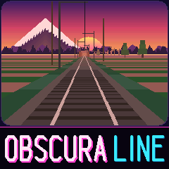

# OBSCURA LINE

<p align="center"></p>

**A mysterious train adventure for the M-VAVE FM-1.**

Built around the FM-1's keys, knobs and sound engine, it blends train driving, mechanical puzzles, synth jams and
rhythm games. Journey around a synthwave loop, repair forgotten machines through sound and logic, and uncover the
mystery at its heart.

## The guide

**[Read the guide](https://mammothcheese.github.io/obscuraline/guide.html)**: what the game is, the few controls
that work everywhere, and how to drive the train. Everything else is explained in the game itself, on a card before
each puzzle and drive.

## Install

Install it from [The Firmware Hub](https://thefirmwarehub.com/), or download the `.fwsc` from
[Releases](https://github.com/MammothCheese/obscuraline/releases/latest) and install it as you would any FM-1
firmware. Switch on, press **PLAY**, and the story takes it from there.

## Build it yourself

On Linux (x86-64), or Windows with WSL: install the JieLi toolchain with `tools/get_toolchain.sh` and check out the
[JieLi AC79 SDK](https://gitee.com/Jieli-Tech/fw-AC79_AIoT_SDK) (tag `AC79NN_SDK_V1.2.1_2023-12-13`) to
`~/fw-AC79_AIoT_SDK`, then:

```sh
pip3 install Pillow numpy
./build.sh                  # -> build/obscura.fwsc
sh tests/run_tests.sh       # the host tests
```

On Windows, `wsl -d Ubuntu -- sh wsl_build.sh` does both from this folder.

The story, the puzzles and the lines are plain text in [`content/`](content/): see `content/README.txt`. Change
them and build again; `tools/content.py` checks them first.

## Credits and licence

OBSCURA LINE by MammothCheese, an Eastlake Games production. Built on
[Dinghy](https://github.com/zvenson/dinghy) (zvenson), on [Felucca](https://github.com/hugelton/Felucca)'s platform
(Leo Kuroshita, Hügelton Instruments) and [SLOOP](https://github.com/isod89/sloop-fm1) (isod89). Font: Terminus.

Free software under the GNU General Public License, version 3 only: see [`LICENSE`](LICENSE), and
[`LICENSING.md`](LICENSING.md) for who made what. Not made or endorsed by M-VAVE.
